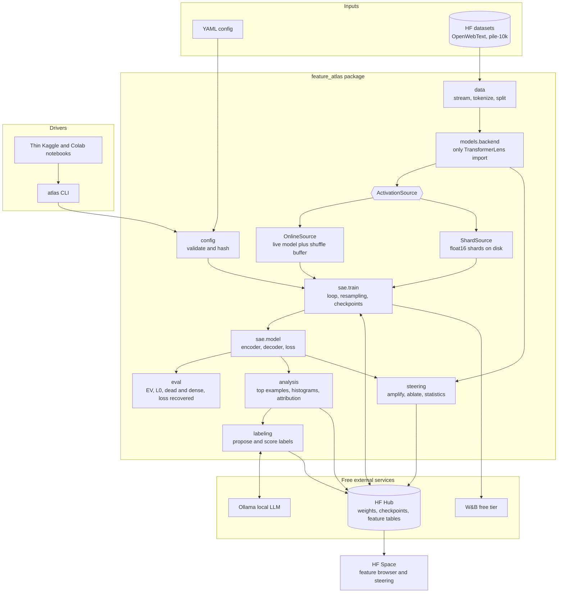

# Feature Atlas: Project Plan

Train sparse autoencoders (SAEs) on GPT-2's internal activations, discover interpretable features, then use them to explain and causally steer the model. All of it runs on free infrastructure.

**Status:** Phase 0, written 2026-11-01.

**Evidence labels used in this document:**

- **[checked]** Verified on 2026-11-01 from package metadata, a dependency resolve, wheel contents or official docs.
- **[computed]** Arithmetic from known sizes.
- **[estimate]** My judgement, not yet measured. Phase 1 and early Phase 3 replace these with measurements.

---

## 1. Summary of decisions

| Decision | Choice | Main reason |
| --- | --- | --- |
| Model | GPT-2 small (`gpt2`, 124M params, `d_model=768`) | Small, heavily studied, and has public reference SAEs |
| Hook point | `blocks.8.hook_resid_pre` | Semantic depth, four downstream blocks for steering, direct reference SAE |
| Hooking library | `transformer-lens>=3.9,<4`, behind a one-file adapter | Only line that coexists with SAELens (section 4) |
| Implemented from scratch | SAE, training loop, metrics, feature analysis, steering | Your explicit learning goal |
| Baseline | Pretrained `gpt2-small-res-jb`, and optionally a SAELens-trained SAE | Independent yardstick |
| Training data | OpenWebText, streamed; held-out split plus `NeelNanda/pile-10k` | Same corpus as the reference SAEs |
| Training activations | Generated online through a shuffle buffer | A reference-scale disk cache would be ~920 GB |
| Packaging | uv | Already installed, fast, cross-platform lockfile |
| Config | Pydantic v2 plus YAML | Validation and clear errors, not just structure |
| Tracking | W&B free tier, with a local JSONL log always on | Public run links for recruiters; no lock-in |
| Artifact storage | Hugging Face Hub | Free for public repos, works from any notebook |
| Local LLM | Ollama (installed, 0.32.14), model chosen in Phase 4 | Free, no API key |
| Demo | Hugging Face Space (Gradio on free CPU) | Can run live steering; GitHub Pages cannot |

---

## 2. Architecture

The core rule is that **dependencies point one way, and only one module knows TransformerLens exists.** The SAE takes plain tensors. It can't tell whether they came from GPT-2, a disk shard or a unit test, so CI can test all of its math with synthetic data.



### Package structure

```text
feature-atlas/
├── src/feature_atlas/
│   ├── config.py           # Pydantic schemas, YAML loading, stable config hash
│   ├── cli.py              # `atlas cache|train|eval|analyze|label|steer`
│   ├── runtime.py          # seeding, device selection, logging, path resolution
│   ├── tracking.py         # Tracker protocol: W&B and JSONL implementations
│   ├── hub.py              # Hugging Face upload and download with retries
│   ├── data/               # text streaming, tokenization, deterministic splits
│   ├── models/backend.py   # ONLY module importing transformer_lens
│   ├── activations/        # source protocol, shards, manifest, shuffle buffer
│   ├── sae/                # model, init, resampling, train, checkpoint
│   ├── eval/               # metrics and loss-recovered evaluation
│   ├── analysis/           # top examples, histograms, attribution, seed matching
│   ├── labeling/           # LLM proposal and held-out label scoring
│   └── steering/           # interventions, experiments, statistics
├── configs/                # one YAML per experiment; the results' source of truth
├── notebooks/              # thin drivers only
├── app/                    # Hugging Face Space
├── tests/                  # fast CPU tests; network tests carry a `slow` marker
├── docs/                   # PLAN, PROGRESS, technical report
├── CLAUDE.md
└── pyproject.toml, uv.lock, .pre-commit-config.yaml, .github/workflows/
```

### Data flow and storage

1. **Text to tokens.** Stream documents, tokenize, and concatenate into fixed 128-token contexts. The split is assigned by hashing each document, so it stays deterministic in streaming mode, where you can't take a random index.
2. **Tokens to activations.** The backend runs the model only up to block 8, using TransformerLens's `stop_at_layer`. Skipping the last four blocks saves about a third of the work.
3. **Activations to SAE.** Tokens in one context are highly correlated, so they go through a shuffle buffer. Without it, each SAE batch would be dominated by a few documents.
4. **SAE to analysis.** Sparse feature activations are stored as `(token_position, feature_id, value)` rows.
5. **Analysis to demo.** The Space only reads precomputed tables from the Hub, plus the SAE weights for live steering.

### Why both online and cached activations

Each token costs 768 × 4 = 3,072 bytes at float32 **[computed]**.

| Tokens | float32 | float16 plus uint16 token id |
| --- | --- | --- |
| 10M | 30.7 GB | 15.4 GB |
| 100M | 307 GB | 154 GB |
| 300M (reference SAE's budget) | 922 GB | 461 GB |

That doesn't fit on a free notebook disk, whose size is small and should be confirmed in Phase 1. So there are two roles behind one interface:

- **Shard cache (the Phase 1 pipeline you specified):** tests, laptop runs, evaluation sets, analysis corpus and bit-exact resume tests. Target 5M to 10M tokens.
- **Online source:** real training runs, trading GPU time for disk.

Shards are `.npy` files with a JSON manifest holding the config hash, shape and checksum. I chose `.npy` over safetensors because `numpy.memmap` allows random access without loading a whole shard. float16 halves the size. Its roughly 0.1% relative rounding error should be far below reconstruction error, and Phase 1 will test that rather than assume it. Token ids fit in `uint16` because GPT-2's vocabulary is 50,257.

### How notebooks drive the package

A notebook has about four cells: install a pinned commit, read secrets from Kaggle or Colab's secret store, set the config path, and call `atlas train`.

- It installs with `pip install "git+https://github.com/<user>/feature-atlas@<sha>"`. Pinning a SHA ties each result to exact code.
- `torch` is a lower bound, not an exact pin, so notebooks keep their pre-installed CUDA-matched build. The exact `uv.lock` applies to laptop and CI.
- `runtime.py` detects Kaggle, Colab or local and resolves paths, so no path is hardcoded.

### Checkpointing and resume

Free sessions can end without warning, so every run must assume that it will be killed.

- **What is saved:** SAE weights, optimizer state, step count, dead-feature counters, all RNG states, the data cursor (`datasets`' `IterableDataset.state_dict()`), and the config hash.
- **How:** write to a temp file, then atomically rename, so a kill mid-write can't corrupt the latest checkpoint.
- **Where:** locally every ~10 minutes and to a private Hub repo every ~30 minutes. The second is the copy that survives a session.
- **Resume safety:** refuse to resume if the config hash doesn't match.
- **Size:** a 32× checkpoint is about 450 MB, made up of 151 MB of weights and 302 MB of Adam state **[computed]**. Keep only the last two. Deleted files can stay in Hub history, so squash that history periodically.

**Reproducibility, stated accurately:** resuming from shards can be bit-exact and CI will test it. Online resume is *statistically* equivalent but not bit-identical, because the shuffle buffer isn't saved (it's ~1.6 GB). GPU execution also has some inherent nondeterminism. We'll report results across seeds with spread, and never claim bit-identical GPU runs.

---

## 3. Model, layer and activation site

**Model: GPT-2 small.** It's small enough for free GPUs (~0.5 GB of weights). The deciding reason is that public reference SAEs exist for it, which makes "my SAE compared with a known-good one" a real, checkable result. Pythia models are smaller but offer less to compare against. They remain an option only if compute becomes a blocker.

**Layer: start of block 8 of 12.** Early layers tend to be token and syntax oriented, while the last layers lean toward prediction of the next token. Block 8 sits between them, and leaves blocks 8 to 11 downstream so steering has room to propagate. The reference `gpt2-small-res-jb` release has a `blocks.8.hook_resid_pre` SAE, a 32× dictionary (`d_sae=24,576`) trained for 300M tokens with context 128 **[checked]**.

**Site: residual stream.** It's the shared channel that every later block reads from and writes to, so editing it reaches all downstream computation. It also approximates a sum of contributions, which matches an SAE's assumption that activations are sparse linear combinations of directions. The tradeoff is that it carries a lot of information, so it's harder to reconstruct than a narrower site.

---

## 4. Libraries, and what you implement yourself

### The TransformerLens decision

| Option | Result |
| --- | --- |
| TL 4.3 (latest) | `HookedTransformer` is removed **[checked]**. SAELens requires `<4`, so no SAELens in the same environment **[checked]** |
| **TL 3.9 (recommended)** | Resolves with SAELens 6.54.12 and torch 2.15 **[checked]**. `HookedTransformer` works with a deprecation warning **[checked]** |
| Plain PyTorch hooks on `transformers` | No TL dependency, but you rebuild hook-point and run-from-layer utilities |

**Recommendation: TL `>=3.9,<4` behind `models/backend.py`.** The cost is using a deprecated API. Keeping it in one file makes a later move to `TransformerBridge` a contained change.

### Pitfall: centred weights

The reference SAE's config sets `center_writing_weights: true` **[checked]**. TL also folds LayerNorm by default. So its activations aren't numerically the same as raw Hugging Face GPT-2's. Fair comparison requires evaluating both SAEs on activations produced with identical settings. Phase 1 will pin those settings in the config and test that the model's logits still match Hugging Face within tolerance. Evaluating the baseline on the wrong activations would give a clean-looking, wrong result.

### Implement versus reuse

| Yours, from scratch | Reused |
| --- | --- |
| SAE encoder, decoder, loss | PyTorch |
| Decoder normalization and gradient projection | TransformerLens (hooks only) |
| Dead-feature detection and resampling | `datasets`, `huggingface_hub` |
| Training loop, checkpoint and resume | SAELens (baseline only, optional extra) |
| Shard store and shuffle buffer | Pydantic, Typer, W&B client |
| All metrics; feature analysis; steering | Gradio, Ollama |

SAELens goes in an optional `[baseline]` extra. Core code must never import it, or "from scratch" stops being true.

### SAE core math (implemented in Phase 2)

Encoder and decoder:

```text
f(x) = ReLU(W_enc (x - b_dec) + b_enc)     # x: [batch, 768], f: [batch, d_sae]
x̂    = W_dec f(x) + b_dec                  # W_dec: [768, d_sae]
L    = ||x - x̂||² + λ ||f(x)||₁
```

Each of these details matters, and each is a likely interview question:

- **Decoder unit norm.** Without it, the L1 penalty can be dodged by shrinking `f` and growing `W_dec` to compensate. Sparsity would be an illusion. Each column is renormalized after every step.
- **Gradient projection.** The gradient's component parallel to each decoder column is removed before the step, because it would only change the norm that gets reset anyway. With Adam it would also pollute the momentum estimates.
- **Dead features.** A ReLU that never fires gets no gradient and never recovers. Features inactive for a long window are resampled toward poorly reconstructed inputs, the approach from Anthropic's dictionary-learning work.
- **`b_dec` initialization.** The geometric median of a batch of activations lets the dictionary model variation around the centre instead of spending features on the mean.
- **L1 warm-up.** Starting λ at zero prevents sparsity from killing features before they've learned anything.

**Comparability warning:** λ depends on loss conventions (sum or mean, activation scale), so λ values aren't comparable across implementations. We compare at matched L0 and explained variance, never by λ.

---

## 5. Compute budget

Treat every figure here as a planning estimate until Phase 1 measures throughput.

**Kaggle is primary.** Reports put its GPU quota around 30 hours a week, with 12-hour sessions and T4 or P100 cards. Kaggle publishes no fixed number, so check your account's live quota **[checked, unofficial]**. Quota counts session time and not GPU utilization, so an idle notebook still burns it. Colab is the backup, since its limits are unpublished and variable.

| Experiment | Runs | Each | GPU hours **[estimate]** |
| --- | --- | --- | --- |
| Throughput benchmark | 1 | 0.5 h | 0.5 |
| Sweep: 3 sizes × 4 λ at 50M tokens | 12 | 0.5 h | 6 |
| Final SAE, 300M tokens, 3 seeds | 3 | 3 h | 9 |
| TopK comparison | 1 | 3 h | 3 |
| Evaluation and analysis passes | 4 | 0.5 h | 2 |
| **Total** | | | **~20** |

This assumes ~50k tokens per second **[estimate]**. If real throughput is half that, the work takes two quota weeks instead of one, which the timeline allows. If Kaggle still offers two T4s, one session could run two sweep configs in parallel, one per GPU.

**Memory:** GPT-2 (0.5 GB) plus the SAE and Adam state (0.45 GB at 32×) fit comfortably on a 16 GB card **[computed]**, leaving room for the activation batches. The 64× size doubles the SAE share and is still fine.

---

## 6. Beyond the spec

Ranked by interview value per unit of effort.

| # | Idea | Why it impresses | Cost | Phase |
| --- | --- | --- | --- | --- |
| 1 | **Placebo controls everywhere.** Compare with random directions in steering and shuffled labels in scoring | Shows scientific discipline; most hobby projects skip it | Low | 4, 5 |
| 2 | **Is an SAE better than PCA or raw neurons?** Same interpretability tests on those bases | Justifies the method instead of assuming it | Low | 4 |
| 3 | **Seed stability.** Match decoder directions across 3 seeds with the Hungarian algorithm | Answers "are features real or noise?" with a number | Low | 3 |
| 4 | **ReLU versus TopK encoder.** Compare the L1 approach with OpenAI's TopK | Lets you discuss tradeoffs from your own data | Low | 3 |
| 5 | **Correlation versus causation score.** How often does logit attribution predict what steering actually does? | The core question of Phase 5, as one number | Medium | 5 |
| 6 | **Steering against a simple baseline.** Compare with a mean-difference steering vector | Shows whether SAE precision pays off | Medium | 5 |
| 7 | **Safety case study.** Ablate features linked to toxic continuations, measured by a free classifier | Direct AI-safety relevance | Medium | 5 |
| 8 | **Feature circuits across layers.** Which layer 2 features cause which layer 8 features? | Research-grade if it works | High | Stretch |
| 9 | **Published Hub model card and `atlas` CLI** | Shows product and release habits | Low | 3, 7 |

In scope: 1 to 5 and 9. If time permits: 6. Stretch goals: 7 and 8.

---

## 7. Phase design notes

The phases and their ordering are as you specified. These are the decisions that the spec left open.

**Phase 1 (Foundations).** CI uses a tiny, randomly initialized `HookedTransformer` built from config (e.g. `d_model=32`, 2 layers), so no downloads are needed. Exit criteria: measured tokens per second on your M1 Pro and on a Kaggle GPU, and confirmed free-tier disk size.

**Phase 2 (SAE).** Tests cover gradient flow, the unit-norm invariant after a step, that gradient projection really is orthogonal, that a kill-and-resume run matches an uninterrupted one on shards, and recovery of known sparse structure from synthetic data. That last test is the most convincing: if the SAE can't recover a dictionary you planted, nothing downstream is trustworthy.

**Phase 3 (Experiments).** Primary axis is explained variance against L0, plus loss recovered:

```text
loss recovered = (CE_zero - CE_sae) / (CE_zero - CE_original)
```

`CE_zero` replaces the activations at the hook with zeros. Run the baseline evaluation **first**, because it gives us a real target. No result target appears in this plan on purpose; we'll write it down after measuring the baseline.

**Phase 4 (Interpretation).**

- Mid-layer logit attribution isn't a simple linear readout, since four blocks sit between the hook and the output. We'll measure it directly: perturb along a feature's direction and rerun the remaining blocks.
- Labelling all 24,576 features is unrealistic locally. At ~20 s per label **[estimate]** it would take ~6 days. We'll label a stratified sample of 1,000 to 2,000, by activation frequency, and report that it's a sample. Kaggle's GPU can run Ollama if more are needed.
- Scoring: the LLM classifies held-out snippets using only the label. Negatives include hard ones containing the same token. Report AUROC against the shuffled-label control.
- Manual spot-check: 100 randomly sampled labels, judged with a rubric fixed in advance, reported with a Wilson confidence interval (about ±10 points at n=100).

**Phase 5 (Steering).**

- Amplify: `x' = x + α d_i`, with α in units of the feature's typical activation.
- Ablate: `x' = x - f_i(x) d_i`. This keeps the SAE's reconstruction error in place, so the *only* change is that feature's contribution.
- Prompts, metrics and features are fixed before looking at results.
- Statistics are paired tests with bootstrap confidence intervals, Benjamini-Hochberg correction across features, and same-norm random directions as a placebo.
- Case study: sentiment first, since it has a free classifier and an easy-to-read effect.

**Phase 6 (Demo).** A Gradio Space on free CPU (2 vCPU, 16 GB RAM **[checked]**) reads Parquet feature tables and runs GPT-2 for short steering prompts. Fallback is precomputed examples if live generation is too slow. Spaces sleep after about 48 hours of inactivity and wake on visit **[checked]**, so a recruiter may see a cold start. Your README will include screenshots and a GIF for that reason. ZeroGPU isn't relied on, as the docs and third-party sources conflict on its terms.

**Phase 7 (Write-up).** README, technical report, limitations stated plainly.

---

## 8. Tooling

- **uv:** chosen over Poetry for speed and because it also manages Python versions. It's already installed.
- **Python:** `>=3.11`. CI tests 3.11 and 3.12. Your laptop uses 3.12.
- **Quality:** ruff, mypy, pytest and pre-commit. pre-commit runs through uv, so it needs no global install.
- **CI:** GitHub Actions on a public repo, running lint, types and CPU tests.
- **Tracking:** W&B free tier is metrics only, so its 5 GB a month is enough **[checked]**. An academic plan with 200 GB exists for students with an academic email doing non-commercial research **[checked]**, but isn't needed. The pricing page doesn't say whether signup needs a card. If it asks for one, stop and use TensorBoard. Training never depends on W&B: JSONL logging is always on, and CI runs without it.
- **Hub storage:** public storage is described as best-effort and private is 100 GB **[checked]**. Only final weights and feature tables are public. Rolling checkpoints stay private and get pruned.

**Git:** one `phase-N/...` feature branch per phase, Conventional Commits, PR after green CI, tags at milestones (v0.1.0 after Phase 2). Nothing is pushed until you approve the first push. Commits use your configured identity with no AI attribution.

---

## 9. Timeline

Assumes ~9 hours a week. Hours are estimates, and weeks assume no exam disruption.

| Phase | Hours | Weeks | Cumulative | Milestone |
| --- | --- | --- | --- | --- |
| 0 Planning | 4 | 0.5 | 0.5 | Plan approved |
| 1 Foundations | 18 | 2 | 2.5 | Throughput measured, CI green |
| 2 SAE from scratch | 27 | 3 | 5.5 | **v0.1.0** |
| 3 Experiments | 27 | 3 | 8.5 | First real resume numbers, **v0.2.0** |
| 4 Interpretation | 27 | 3 | 11.5 | Honest label accuracy, **v0.3.0** |
| 5 Steering | 22 | 2.5 | 14 | Causal results, **v0.4.0** |
| 6 Demo | 15 | 1.5 | 15.5 | Public demo |
| 7 Write-up | 12 | 1.5 | 17 | **v1.0.0** |

Total: about 150 hours, or 17 weeks. Starting the week of 2026-11-02 and with no slip, that lands around early March 2027. Allow extra for finals; winter break could win that time back.

**If time runs short, cut in this order:** the optional SAELens-trained arm, then idea 6, then live steering in the demo. Don't cut placebo controls or the baseline comparison, which are what make the results credible.

---

## 10. Risks

| Risk | Likelihood | Mitigation |
| --- | --- | --- |
| Session killed mid-training | Certain | Atomic checkpoints with Hub sync; resume tested in CI |
| Throughput is well below estimate | Medium | Measured in Phase 1; reduce the sweep before final runs |
| Free-tier terms change | Medium | Tracker and storage sit behind thin interfaces; Colab as backup |
| My SAE underperforms the baseline | Medium | Synthetic recovery test first; debug at matched settings. A documented gap is still a valid result |
| Baseline evaluated on mismatched activations | Medium | Pinned settings and a logits-match test |
| TL 3.x goes stale | Low in project lifetime | Adapter file; versions locked |
| Local LLM labels are vague | High | Hard negatives, placebo, manual check. Report the real number, even if unimpressive |
| Steering effects are weak or nonlinear | Medium | Sweep α; pick features by effect only on a separate split; report failures too |
| Feature discovery surfaces offensive text from web data | Certain | Keep it out of curated demo defaults; add a filter and a note in the Space |
| Pile-10k overlaps with OpenWebText | Possible | Filter by document hash; treat as a shift check |
| Scope creep in a 17-week plan | High | Phase gates and the cut list above |

---

## 11. Decisions confirmed

Confirmed by you on 2026-11-01:

- **Commit identity:** GitHub noreply address, set for this repo only.
- **Deadline:** none, so the full plan runs at the pace in section 9.
- **Focus:** general ML engineering. The Phase 5 case study is sentiment, and optional time goes to engineering quality, benchmarks and the demo. The toxicity study (idea 7) and feature circuits (idea 8) move to stretch goals.
- **Hooking:** TransformerLens 3.9 behind the one-file adapter.

**Accounts you'll need before Phase 3, all free:** Hugging Face, Kaggle (GPU access may need phone verification) and W&B.

---

## 12. References

**Research (cited from memory; confirm exact citations when writing the Phase 7 report):**

- Cunningham et al., 2023. *Sparse Autoencoders Find Highly Interpretable Features in Language Models.*
- Anthropic, 2023. *Towards Monosemanticity: Decomposing Language Models With Dictionary Learning.*
- Gao et al. (OpenAI), 2024. *Scaling and Evaluating Sparse Autoencoders.*
- Paulo et al. (EleutherAI), 2024. *Automatically Interpreting Millions of Features in Large Language Models.*

**Sources checked for this plan:**

- [SAELens pretrained SAE registry](https://github.com/decoderesearch/SAELens/blob/main/sae_lens/pretrained_saes.yaml)
- [Reference SAE weights and config on Hugging Face](https://huggingface.co/jbloom/GPT2-Small-SAEs-Reformatted)
- [TransformerLens on PyPI](https://pypi.org/project/transformer-lens/) and [SAELens on PyPI](https://pypi.org/project/sae-lens/)
- [Hugging Face Hub storage limits](https://huggingface.co/docs/hub/storage-limits)
- [Hugging Face Spaces overview](https://huggingface.co/docs/hub/spaces-overview)
- [Weights & Biases pricing](https://coreweave.com/forge-pricing)
- [Free cloud GPU summary, 2026 (third party, Kaggle quota is unofficial)](https://gpuperhour.com/blog/free-cloud-gpus-and-credits)
